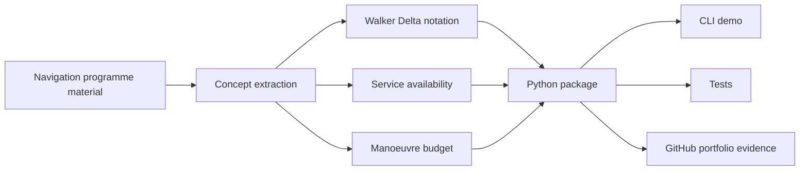

# Galileo Mission Analysis Toolkit


A polished, test-backed Python portfolio project demonstrating GNSS mission-analysis concepts inspired by ESA Navigation Training Course material.

It translates Galileo navigation learning into a small engineering toolkit: Walker Delta constellation notation, constellation service availability, simplified Galileo-altitude manoeuvre budgeting, and clear documentation of assumptions.

> This is a portfolio-grade learning project, not an operational Galileo, flight dynamics, or mission operations tool.

## Project Snapshot

| Area | What this demonstrates |
|------|------------------------|
| GNSS / Galileo literacy | Constellation design language, service continuity, reliability, mission operations vocabulary |
| Mission analysis | Walker notation, orbital plane spacing, relocation, disposal, delta-v budgeting |
| Systems thinking | Assumptions, caveats, traceability, verification, and clean boundaries |
| Python engineering | `src/` layout, dataclasses, CLI, examples, tests, package metadata |

## What It Models



## Features

| Feature | File | What it shows |
|---------|------|---------------|
| Walker Delta parser | `src/galileo_mission_analysis/walker.py` | Parses notation such as `56:24/3/1` and derives plane/satellite spacing |
| Availability model | `src/galileo_mission_analysis/availability.py` | Computes constellation state probabilities and service probability over time |
| Manoeuvre budget | `src/galileo_mission_analysis/maneuvers.py` | Estimates simplified Galileo-altitude correction, relocation, and disposal delta-v |
| CLI scenario | `src/galileo_mission_analysis/cli.py` | Runs an integrated portfolio demo |
| Standalone example | `examples/run_reference_scenario.py` | Lets reviewers run the scenario without installing the package |
| Tests | `tests/` | Verifies the core calculations and edge cases |

## Navigation Concepts Covered

The project explains and demonstrates:

- GNSS positioning basics
- Galileo as a navigation-system context
- constellation design
- Walker Delta notation
- satellite reliability
- service availability
- state probabilities
- semi-major-axis correction
- inclination correction
- RAAN correction
- relocation phasing
- disposal planning
- delta-v budgeting
- ideal rocket equation propellant estimate
- signal-in-space processing context
- SDR / I/Q / acquisition roadmap
- systems engineering and MBSE traceability mindset

Start here: [Concept Guide](docs/CONCEPTS.md)

## Navigation Programme Mapping

The repo incorporates the learning themes from the extracted navigation programme material without copying course slides or raw workbook content.

| Navigation programme theme | Project artifact |
|----------------------------|------------------|
| Galileo constellation and mission analysis | Walker notation and reference scenario |
| Service availability computation | `availability_timeline` and state probability functions |
| Satellite reliability | `Satellite` model and reliability decay timeline |
| Delta-v budget exercises | `galileo_altitude_budget` |
| Station-keeping, relocation, disposal | Manoeuvre budget categories |
| Galileo signal / SIS processing | Explained in docs and future SDR acquisition roadmap |
| Requirements and system modelling | Assumptions, caveats, tests, and traceability docs |
| Capella / ARCADIA / MBSE | Reflected through concept-to-code-to-test mapping |

Read the full mapping: [Navigation Programme Mapping](docs/NAVIGATION_PROGRAMME_MAPPING.md)

## Quick Start

```bash
python -m venv .venv
.venv\Scripts\activate
pip install -e .
galileo-mission-analysis
```

Run without installing:

```bash
python examples/run_reference_scenario.py
```

## Example Output

```text
Galileo Mission Analysis Portfolio Demo
--------------------------------------
Walker notation: 56:24/3/1
Satellites per plane: 8
Plane separation: 120.0 deg
Adjacent-plane phase: 15.0 deg

Approximate manoeuvre budget
- semi_major_axis_mps: 6.20 m/s
- inclination_mps: 7.68 m/s
- raan_mps: 6.37 m/s
- relocation_mps: 51.26 m/s
- disposal_mps: 12.00 m/s
- total_mps: 83.51 m/s
- propellant for 700 kg dry mass, 220 s Isp: 27.63 kg
```

## Project Structure

```text
galileo-mission-analysis-toolkit/
  README.md
  pyproject.toml
  LICENSE
  docs/
    CONCEPTS.md
    GITHUB_UPLOAD.md
    NAVIGATION_PROGRAMME_MAPPING.md
  examples/
    run_reference_scenario.py
  src/
    galileo_mission_analysis/
      availability.py
      cli.py
      maneuvers.py
      walker.py
  tests/
    test_availability.py
    test_maneuvers.py
    test_walker.py
```

## Tests

```bash
python -m pytest tests -q -p no:cacheprovider
```

Expected result:

```text
7 passed
```

## Technical Caveats

This toolkit is intentionally simplified.

| Simplification | Real operational model would need |
|----------------|-----------------------------------|
| Independent satellite failures | Correlated failures, component reliability, operational history |
| Linear reliability decay | Reliability model fitted to real data |
| At-least-N service probability | User geometry, DOP, orbit propagation, ground segment constraints |
| Galileo-altitude rules of thumb | High-fidelity astrodynamics and manoeuvre planning |
| Disposal as an input term | Full end-of-life strategy and compliance analysis |

The point is not to pretend this is flight software. The point is to show transparent engineering reasoning.

## GitHub Upload

Step-by-step instructions are here: [GitHub Upload Guide](docs/GITHUB_UPLOAD.md)

Recommended repository description:

```text
Python toolkit demonstrating GNSS mission-analysis concepts: Walker Delta notation, constellation availability, and simplified Galileo-altitude manoeuvre budgeting.
```

Recommended topics:

```text
python, gnss, galileo, satellite-navigation, mission-analysis, orbital-mechanics, pytest, portfolio
```

## Next Improvements

- Add a simple Dilution of Precision style geometry module.
- Add a synthetic SDR/GNSS acquisition explainer using code-phase and Doppler search.
- Add availability plots from the reference scenario.
- Add JSON scenario inputs for different constellation designs.
- Add a requirements trace table connecting docs, functions, and tests.

## Portfolio Positioning

This project supports applications for GNSS, mission analysis, satellite systems, and navigation roles by showing that Galileo/navigation training has been converted into executable, documented, tested work.

