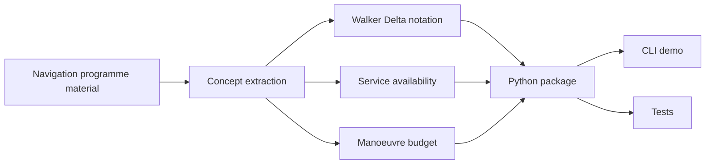

# Galileo Mission Analysis Toolkit


A planned Python toolkit for GNSS mission-analysis concepts inspired by ESA Navigation Training Course material.

The repository is a scaffold. This branch has no package source, examples, concept notes, or tests, and there is no command to run.

> This is intended as a learning project, not an operational Galileo, flight dynamics, or mission operations tool.

## Current state

| Path | What is here |
|------|----------------|
| `README.md` | This description and the roadmap below |
| `LICENSE` | MIT license |
| `pyproject.toml` | Metadata for the `galileo-mission-analysis-toolkit` distribution: Python 3.10+, MIT, author, and the repository URL. It does not declare a console script or a package layout. |
| `.gitignore` | Ignores virtual environments, bytecode, pytest cache (including leftover `pytest-cache-files-*` temp directories), and build artifacts |

## Roadmap

The intended scope is a small engineering toolkit that turns Galileo navigation learning into explicit models, with assumptions written down beside the calculations. The learning themes come from navigation programme material. The project is meant to explain those ideas in original notes and code, without copying course slides or workbook content.

### Design



Areas the finished toolkit is meant to demonstrate:

| Area | Intended emphasis |
|------|-------------------|
| GNSS / Galileo literacy | Constellation design language, service continuity, reliability, mission-operations vocabulary |
| Mission analysis | Walker notation, orbital plane spacing, relocation, disposal, delta-v budgeting |
| Systems thinking | Assumptions, caveats, traceability, verification, and clean boundaries |
| Python engineering | `src/` layout, dataclasses, a CLI, examples, tests, and package metadata |

### Planned modules

| Feature | Intended path | What it would do |
|---------|---------------|------------------|
| Walker Delta parser | `src/galileo_mission_analysis/walker.py` | Parse notation such as `56:24/3/1` and derive plane and satellite spacing |
| Availability model | `src/galileo_mission_analysis/availability.py` | Compute constellation state probabilities and service probability over time |
| Manoeuvre budget | `src/galileo_mission_analysis/maneuvers.py` | Estimate simplified Galileo-altitude correction, relocation, and disposal delta-v |
| CLI scenario | `src/galileo_mission_analysis/cli.py` | Run an integrated demo |
| Standalone example | `examples/run_reference_scenario.py` | Run the same scenario without installing the package |
| Tests | `tests/` | Check the core calculations and edge cases |

### Concepts to cover

- GNSS positioning basics
- Galileo as a navigation-system context
- Constellation design
- Walker Delta notation
- Satellite reliability
- Service availability
- State probabilities
- Semi-major-axis correction
- Inclination correction
- RAAN correction
- Relocation phasing
- Disposal planning
- Delta-v budgeting
- Ideal rocket equation propellant estimate
- Signal-in-space processing context
- A later SDR / I/Q / acquisition explainer
- Systems engineering and MBSE traceability

Concept notes would live in `docs/CONCEPTS.md`. A theme-to-artifact map would live in `docs/NAVIGATION_PROGRAMME_MAPPING.md`.

### Programme themes to map

| Navigation programme theme | Intended artifact |
|----------------------------|-------------------|
| Galileo constellation and mission analysis | Walker notation and a reference scenario |
| Service availability computation | An availability timeline and state-probability functions |
| Satellite reliability | A satellite model and a reliability-decay timeline |
| Delta-v budget exercises | A Galileo-altitude budget |
| Station-keeping, relocation, disposal | Manoeuvre-budget categories |
| Galileo signal / SIS processing | Documentation, plus a later SDR acquisition explainer |
| Requirements and system modelling | Assumptions, caveats, tests, and traceability notes |
| Capella / ARCADIA / MBSE | A concept-to-code-to-test mapping |

### Intended layout

```text
galileo-mission-analysis-toolkit/
  README.md
  pyproject.toml
  LICENSE
  docs/
    CONCEPTS.md
    NAVIGATION_PROGRAMME_MAPPING.md
  examples/
    run_reference_scenario.py
  src/
    galileo_mission_analysis/
      availability.py
      cli.py
      maneuvers.py
      walker.py
  tests/
    test_availability.py
    test_maneuvers.py
    test_walker.py
```

Only `README.md`, `pyproject.toml`, `LICENSE`, and `.gitignore` are in the repository today.

### Modelling caveats

The models are meant to stay simplified, and the documentation should say so.

| Planned simplification | A real operational model would need |
|------------------------|-------------------------------------|
| Independent satellite failures | Correlated failures, component reliability, operational history |
| Linear reliability decay | A reliability model fitted to real data |
| At-least-N service probability | User geometry, DOP, orbit propagation, ground-segment constraints |
| Galileo-altitude rules of thumb | High-fidelity astrodynamics and manoeuvre planning |
| Disposal as an input term | A full end-of-life strategy and compliance analysis |

### Later ideas

- A simple dilution-of-precision geometry module
- A synthetic SDR/GNSS acquisition explainer using code-phase and Doppler search
- Availability plots for the reference scenario
- JSON scenario inputs for different constellation designs
- A requirements trace table connecting docs, functions, and tests

## License

MIT. See [LICENSE](LICENSE).
