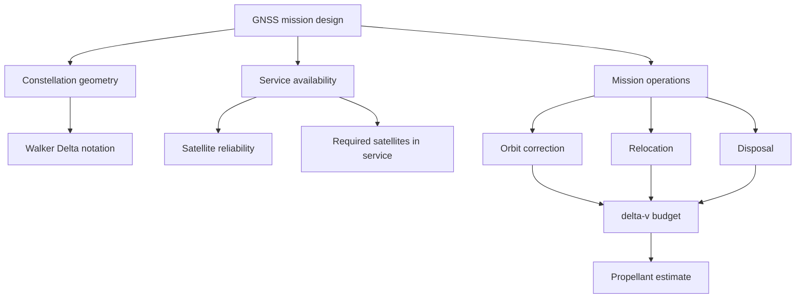

# Concept Guide

This guide explains the navigation and mission-analysis concepts used by the toolkit. The goal is to make the project readable for recruiters, engineers, and interviewers who want to see both domain understanding and software discipline.

## Concept Map



## GNSS

GNSS means Global Navigation Satellite System. GPS, Galileo, GLONASS, and BeiDou are all GNSS constellations. A receiver estimates its position by measuring signals from multiple satellites. In the simplest explanation, each satellite provides a timed ranging signal. The receiver solves for its three-dimensional position and its clock offset.

Why four satellites matter:

- Three unknowns are position: x, y, z.
- One unknown is receiver clock bias.
- Four independent satellite measurements allow the receiver to solve those four unknowns.

Real systems use more than four satellites because extra signals improve geometry, redundancy, robustness, and accuracy.

## Galileo

Galileo is Europe's GNSS. In this project, Galileo is the learning context for:

- constellation design
- navigation signal structure
- signal-in-space processing
- service availability
- mission analysis
- systems engineering

The toolkit does not reproduce Galileo operations. It uses simplified training-style models to show that these concepts can be translated into code.

## Constellation Design

A satellite constellation is the full set of satellites arranged across orbital planes. A GNSS constellation must provide enough visible satellites to users across the service region. Designers think about:

| Design factor | Why it matters |
|---------------|----------------|
| Altitude | Affects coverage footprint, orbital period, signal path, launch energy, and maintenance strategy |
| Inclination | Affects latitude coverage and repeat geometry |
| Number of planes | Spreads satellites around Earth and improves coverage geometry |
| Satellites per plane | Improves redundancy and service continuity |
| Phasing | Controls how satellites in neighbouring planes are offset |

## Walker Delta Notation

Walker Delta notation is a compact way to describe a repeating satellite constellation.

Example:

```text
56:24/3/1
```

Read it as:

| Part | Meaning | Example value |
|------|---------|---------------|
| `56` | Inclination in degrees | 56 deg |
| `24` | Total number of satellites | 24 |
| `3` | Number of orbital planes | 3 |
| `1` | Relative spacing factor between adjacent planes | 1 |

From this, the toolkit computes:

- satellites per plane = total satellites / planes
- plane separation = 360 deg / planes
- in-plane separation = 360 deg / satellites per plane
- adjacent-plane phase = spacing factor * 360 deg / total satellites

This is useful because it turns a compact mission-design notation into inspectable parameters.

## Reliability

Reliability is the probability that a satellite remains healthy enough to perform its function. In this project, reliability is represented as a value between 0 and 1.

Example:

```text
0.985 = 98.5 percent probability of being healthy
```

The project keeps reliability simple by using an independent probability for each satellite. Real spacecraft reliability modelling would be more complex and would include component failure rates, common-mode failures, operational data, ageing, environment, and redundancy.

## Service Availability

Service availability is the probability that the constellation can provide the required service. In the toolkit, this is simplified to:

> What is the probability that at least N satellites are available?

For example:

```text
P(at least 22 of 24 satellites are available)
```

That question connects directly to GNSS operations because navigation service quality depends not only on individual satellites, but on enough satellites being available at the constellation level.

## State Probabilities

The toolkit computes the probability that exactly `k` satellites are available.

Example for three satellites:

```text
P(0 available)
P(1 available)
P(2 available)
P(3 available)
```

The service probability is then the sum of the acceptable states.

Example:

```text
P(at least 2 available) = P(2 available) + P(3 available)
```

The code supports both:

- identical satellites, where each satellite has the same probability
- non-identical satellites, where each satellite may have a different probability

## Orbit Correction

After launch or during operations, a satellite may need orbit correction. This project includes simplified estimates for:

| Correction | Meaning |
|------------|---------|
| Semi-major-axis correction | Adjusting orbital size or altitude-like parameters |
| Inclination correction | Adjusting the tilt of the orbit |
| RAAN correction | Adjusting the orientation of the orbital plane |

The toolkit uses simple Galileo-altitude rules of thumb from training-style exercises. These are useful for learning, but not accurate enough for mission operations.

## Relocation

Relocation means moving a satellite to a different phase position in its orbital plane. A common simplified idea is:

1. Change the semi-major axis slightly.
2. Let the satellite drift relative to the target slot.
3. Circularise or correct back into the target orbit.

The toolkit estimates relocation by converting desired phase drift and relocation time into an approximate semi-major-axis offset, then into a delta-v term.

## Disposal

Disposal is the end-of-life manoeuvre strategy. For operational constellations, satellites should not be left indefinitely in protected or operationally valuable regions. Disposal planning is part of responsible mission operations.

The toolkit treats disposal as an input delta-v term so the user can include it in the total budget.

## Delta-v

Delta-v means change in velocity. It is the "currency" of orbital manoeuvres. If a spacecraft needs to change its orbit, it spends propellant to create delta-v.

The toolkit reports each manoeuvre category in metres per second:

```text
semi_major_axis_mps
inclination_mps
raan_mps
relocation_mps
disposal_mps
total_mps
```

## Propellant Estimate

The toolkit uses the ideal rocket equation to estimate propellant mass:

```text
mass_ratio = exp(total_delta_v / (Isp * g0))
propellant_mass = dry_mass * (mass_ratio - 1)
```

Where:

| Term | Meaning |
|------|---------|
| `total_delta_v` | Total manoeuvre budget in m/s |
| `Isp` | Specific impulse in seconds |
| `g0` | Standard gravity, 9.80665 m/s^2 |
| `dry_mass` | Spacecraft mass without propellant |

This gives a first-order estimate of how much propellant a manoeuvre budget implies.

## Signal-in-Space Processing

The current code does not process real Galileo signals, but the project roadmap includes an SDR/GNSS acquisition explainer. The navigation programme material covered concepts that connect to:

- L-band monitoring
- I/Q samples
- GPS C/A acquisition
- Galileo E1-B/C acquisition
- code phase search
- Doppler search
- correlation

A future module could add a simplified acquisition demonstration using synthetic signals.

## Systems Engineering and MBSE

The navigation programme material also covered requirements engineering and Capella/ARCADIA modelling. This project reflects that mindset through:

- explicit assumptions
- traceable functions
- tests for expected behaviour
- caveats that define model boundaries
- documentation that maps concepts to implementation

That is the software equivalent of keeping requirements, architecture, validation, and limitations connected.

